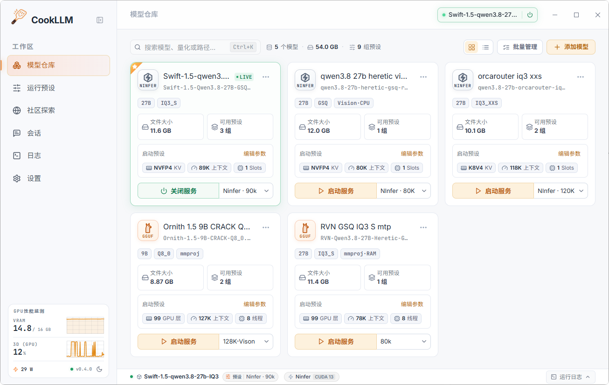
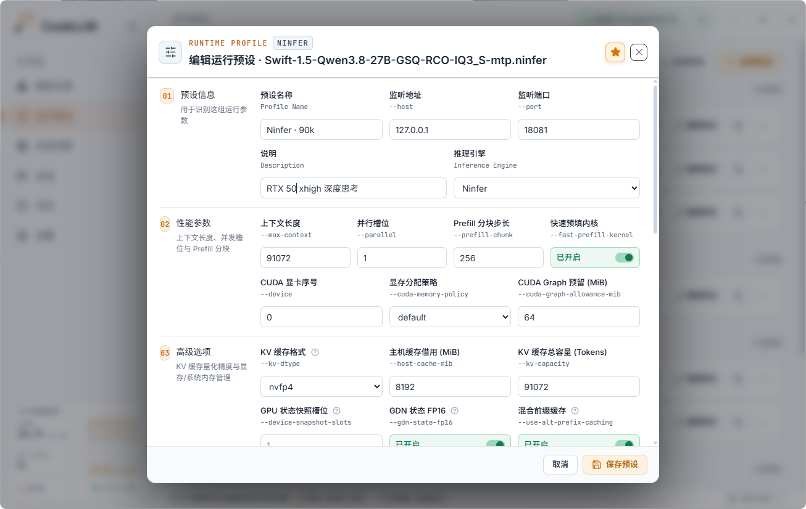
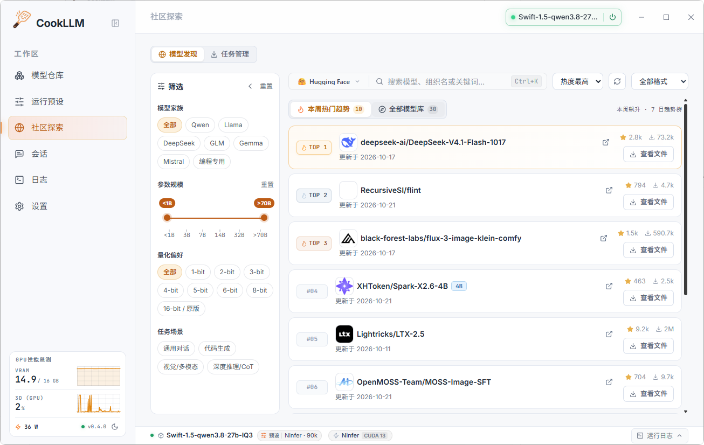
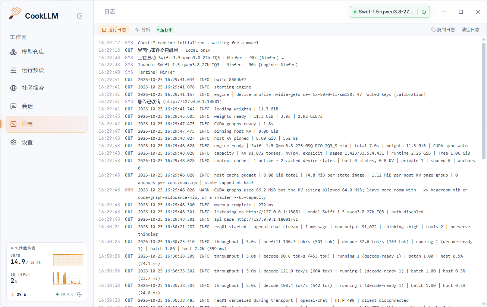
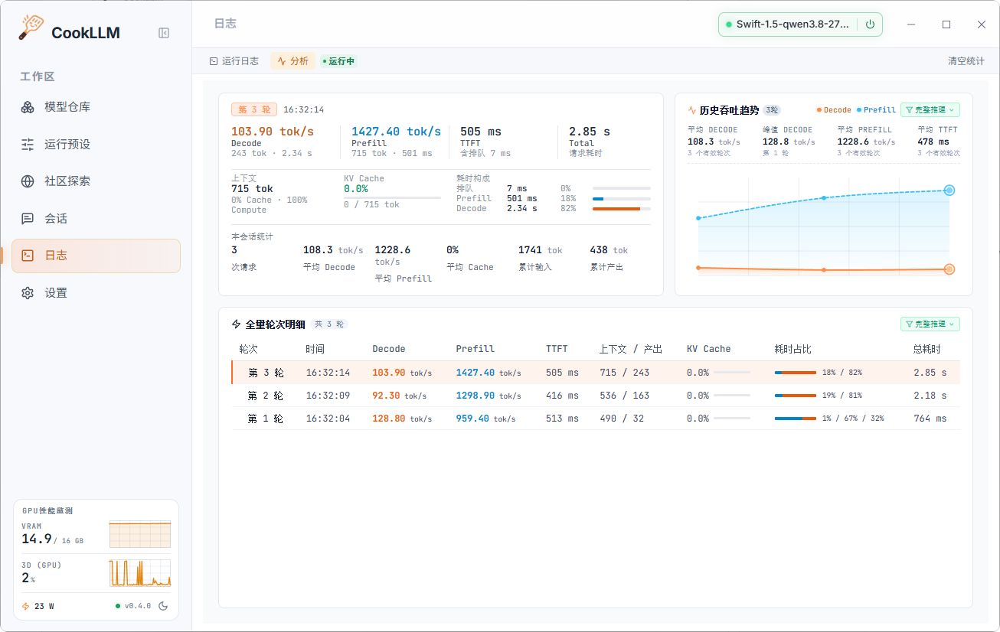
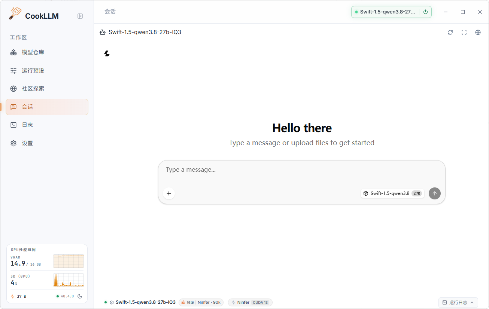

# 🦙 CookLLM

> **llama.cpp / Ninfer / KVMem 轻量管理器** —— 面向 GGUF / Ninfer 模型打造的 Windows 桌面管理程序。
> 内置模型库、运行参数模板、一键启停、显卡状态监控、实时运行日志以及内置对话网页，本地模型管理一套搞定。

---

## ✅ 更新日志

### v0.4.1

#### ✨ 打磨界面细节

- **下拉列表**：优化顶栏下拉列表，调整为胶囊同宽对齐、单行截断。
- **启停按钮**：胶囊与模型卡片按钮样式调整，停止图标由 `■` 改为 `⏻`。
- **优化配色**：关闭服务是正常操作，原配色与红字更像危险或删除提示；现调整为绿色。
- **视图切换精简**：卡片 / 列表切换改为单层边框与纯色选中块，去掉叠加描边和投影。
- **切换引擎优化**：调整界面UI，更新分支引擎时可选择目录自动识别可执行文件。

### v0.4.0

#### ✨ 界面视觉优化

- **GPU 卡片优化**：网格调整，整体界面更为简约，线条统一改成主题色。
- **界面配色调整**：侧边栏移除渐变效果，界面更纯净，主界面背景移除全局橙色光晕。

### v0.3.9

#### 🛠️ 体验修复

- **引擎切换更可控**：浏览引擎分支时，检测到的版本/后端信息仅作展示，点击保存后才写回配置，避免误改。
- **配置导入补全**：增量合并导入现在会一并恢复「探索页侧栏折叠」偏好。
- **文案优化**：引擎管理弹窗标题调整为「切换引擎」，预设引擎提示更清晰。

#### 🧹 底层重构

- **架构整理**：Rust 后端按领域模块拆分，前端页面与状态解耦、样式模块化，行为保持一致，为后续迭代提速。

### v0.3.8

#### 🚀 功能新增与视觉重构

- **全局快捷键**：新增系统级热键（呼出窗口 / 启停服务 / 切换引擎），支持在设置页自定义录制。
- **设置页 UI 重构**：重构「下载授权」与「引擎管理及更新」卡片，优化布局与网格对齐。

#### 🛠️ 性能调优与体验修复

- **KVMem 官方参数对齐**：默认值同步为官方推荐标准（预算 `36864`、生成预留 `16384`、会话数 `1`）。
- **启停交互与动画修复**：启动中支持随时暂停，换模型一键无感切换；彻底修复过渡动画与状态不同步 Bug。
- **托盘唤醒修复**：修复特定场景下系统托盘偶发无法打开主界面的问题。

### v0.3.7

#### 🧩 引擎与配置管理

- **引擎管理及更新**：设置页原「llama.cpp管理及更新」升级为多引擎统一管理，支持全局快捷切换；官方在线更新仅适用于 llama.cpp，其它引擎显示手动替换提示。
- **配置备份导入向导**：新增导入向导，支持智能增量合并 / 完全覆盖还原，含路径前缀重定位与缺失文件保留策略。
- **KV 缓存格式**：Ninfer 预设新增 `--kv-dtype` 选项（支持 RotorQuant 体系、nvfp4、k8v4 等）。

#### ✨ 交互与视觉优化

- **托盘右键菜单重做**：新增状态行（启动中 / 运行中 / 失败）与快捷操作（停止 / 取消启动、打开 WebUI、复制 API 接口）；模型子菜单支持一键切换（带 `[GGUF]/[Ninfer]` 标签与当前项标记），托盘图标呼吸灯随状态变色（黄 / 绿 / 红）。
- **启停过渡动画**：服务启动 / 停止期间按钮显示旋转过渡，引擎真正开始监听后才结束动画、收起日志抽屉并提示「已启动」，避免生硬跳变与过早提示。
- **复制 API 接口**：模型卡 LIVE 徽标支持一键复制 `/v1` 接口地址。
- **风格统一**：全局强调主按钮统一为低饱和琥珀风格。


## 📸 界面预览

### 🏠 主页・模型仓库

统一管理本机所有 GGUF / Ninfer 模型，拖拽文件即可导入，支持搜索、重命名、排序与批量操作。



### 🎛 运行预设

给不同模型保存独立的启动参数，手动精细调参、复制一套新配置，也可以自定义额外命令行参数。




### 🌍 社区探索

内置 Hugging Face 与魔搭社区（ModelScope）双源模型榜单，支持一键切换、筛选、搜索、下载及自动化入库



### 📟 实时日志

实时读取 `llama-server` 的输出数据、报错日志、全量轮次明细，既可在底部抽屉查看，也能切换到全屏日志页面。





### 💬 对话・内置网页对话界面

集成 llama.cpp 官方 WebUI，本地同时提供兼容 OpenAI 格式的 `/v1` 接口，可以对接任意第三方客户端。



---

## ✨ 核心功能

### 🗂 模型仓库

- **快速导入**：拖拽文件或文件夹，也可以手动选择路径，程序自动扫描目录，支持 `.gguf` 与 `.ninfer` 模型，导入后自动生成匹配格式的默认预设
- **自动识别信息**：读取 GGUF 文件头或解析 `.ninfer` 容器元数据，自动获取架构、参数量、量化等级（例如 `Q4_K_M`）
- **灵活管理**：按名称、路径、架构、自定义标签筛选搜索，支持重命名、拖拽排序、快速删除，还能设置默认启动模型
- **标签与量化**：自定义标签、全局标签库与按标签检索，可手动修正未识别或错误的量化信息
- **批量处理**：多选批量删除，左侧面板会直观展示模型数量

### 🎛 运行预设配置

- **完整可调参数**：监听地址、服务端口、GPU 分层加载显存、上下文窗口大小、批处理参数、Flash Attention、KV 缓存方案、Jinja 提示词模板、推理思考强度、内存映射加载、视觉模型 `mmproj` 挂载以及采样相关配置全部支持自定义
- **引擎专属参数**：Ninfer / KVMem 预设提供 KV 缓存量化、预填充分块、MTP 投机采样、KVMem 分层配额等专属选项
- **自由扩展**：新建、复制、删除配置模板，额外补充自定义命令行启动参数

### 🚀 一键启停与进程管理

- 使用 Rust 托管 `llama-server` / Ninfer 子进程，自动检测进程 PID 和端口状态，顶部按钮一键开启关闭
- 停止服务时完整杀掉整个进程树，彻底解决显存占用无法释放的问题
- **残留清理**：启动时检测上次未正常退出遗留的服务进程，可一键结束，避免端口与显存被占用

### 🖥 系统托盘与全局快捷键

- **托盘状态**：图标呼吸灯随状态变色（启动中黄 / 运行中绿 / 失败红），右键菜单显示当前模型与端口
- **快捷操作**：托盘内停止或取消启动、打开 WebUI、复制 API 接口，并可直接启动或切换模型（标注 `[GGUF]` / `[Ninfer]`）
- **全局快捷键**：呼出窗口 / 启动服务 / 停止服务 / 切换引擎，支持设置页自定义录制与冲突检测
- **关闭最小化**：关闭窗口时最小化到托盘，服务在后台继续运行

### 📈 显卡实时监控

- 调用 `nvidia-smi` 定时读取显存占用与显卡负载，每 2 秒刷新一次数据
- 侧边小卡片 + 顶部性能条展示状态，附带三分钟负载波动小曲线图
- **开关可控**：程序会自动识别显卡类型，如果是 AMD 或者不支持读取状态的显卡，会给出提示，你可以关闭监控避免无用轮询

### 📟 实时日志面板

- 实时捕获程序输出和报错，按照 **ERR / WRN / SYS / OUT** 不同级别用不同颜色区分展示
- 底部可拉伸收起的控制台，还有独立全屏日志页面，支持一键清空与复制日志

### 📊 推理性能分析

- **双轨指标**：实时统计 Decode / Prefill 吞吐、TTFT、队列耗时与上下文 KV 缓存命中率
- **逐轮明细**：按请求保留每轮耗时、生成 Token 数与阶段状态，支持轮次锁定与多类型筛选
- **可视化趋势**：吞吐曲线、上下文构成与会话均值面板，快速定位性能瓶颈

### 💬 对话能力与 OpenAI 兼容接口

- **内嵌 WebUI**：对话页内嵌 llama.cpp 官方 WebUI，支持刷新、沉浸模式（F11）与在系统浏览器中打开
- **接口兼容**：本机提供标准 `/v1/chat/completions` 接口，运行中的模型卡 LIVE 徽标可一键复制接口地址

### ⚙️ 完全本地运行，保护隐私

- **不上传任何数据**：模型列表、参数配置、对话记录全部保存在你的电脑本地
- **安全写入配置**：采用临时文件替换写入机制，避免异常退出导致配置文件损坏
- **明暗双主题**：一键切换浅色 / 深色模式，设置自动保存生效
- **中英双语**：界面支持简体中文 / English 一键切换

### 💾 配置备份与恢复

- **一键备份**：导出模型列表、预设、引擎及界面配置，备份文件不包含下载 Token
- **导入向导**：支持智能增量合并或完全覆盖还原，自动重定位路径前缀并保留本机缺失文件
- **配置目录**：设置页可直接打开配置文件夹，便于手动留存与迁移

### 🔄 应用自动更新

- **检测更新**：启动后每 30 分钟自动检测 GitHub Release，也可手动检查，发现新版本弹窗展示更新日志
- **一键升级**：下载安装包并启动安装程序，支持取消与稍后提醒
- **开关可控**：可在设置中关闭自动检测

---
### 🧭 引擎管理（llama.cpp / Ninfer / KVMem）

统一管理 llama.cpp、Ninfer 与 Ninfer-KVMem 三类引擎分支，引擎与运行预设可自由组合，启动时自动匹配对应引擎。

- **引擎分支**：登记 `llama-server.exe`、`ninfer-serve.exe`、`ninfer-kvmem-server.exe` 等可执行程序，选择目录时自动扫描多个 Server 程序并辅助挑选，按可执行文件与运行时探测识别架构类型
- **预设绑定**：每个运行预设可跟随全局主引擎，也可固定指定分支，切换模型时自动使用对应引擎，支持独立路径配置
- **自动识别**：启动检测 NVIDIA、Vulkan 环境，自动选用 CUDA/Vulkan/CPU 最优加速方案并显示显卡
- **一键更新**：拉取 llama.cpp 官方 Windows 版本，自动匹配后端与 CUDA 版本；Ninfer / KVMem 分支按提示手动替换
- **强制修复**：同版本文件损坏时可重新下载安装

### 🌐 网络与代理

- **网络模式**：跟随系统 / 手动 HTTP/SOCKS5 代理 / 直连
- **手动代理**：填入如 `http://127.0.0.1:7890` 等代理地址，通过 `reqwest::Proxy::all` 动态注入所有请求
- **自动检测系统代理**：Windows 下读取注册表 `HKCU` 代理设置，代理失效 / 网络异常时多通道设下载可自动切换直连或本地代理重试
- **连接测试**：一键测试与 GitHub API 的连通性，显示状态码与延迟

### 🌍 社区探索（Hugging Face / ModelScope）

内置 Hugging Face 与魔搭社区（ModelScope）双源，检索、榜单与下载流程一致，可随时切换来源。

- **双源切换**：Hugging Face 与魔搭社区一键切换并自动记忆偏好；ModelScope 支持国内直连，无需代理即可检索与下载
- **下载授权**：配置 Hugging Face Token 后可访问 gated 模型，支持账号校验与连接测试
- **热门榜单**：展示当周 Hugging Face / ModelScope Trending 模型，支持 GGUF / NINFER 格式筛选、刷新与收起
- **全量搜索**：支持两个社区的模型 / 组织 / 关键词搜索，可按格式、热度 / 时间排序；列表支持触底分页加载，无限向下浏览
- **托管下载**：按来源调用对应社区接口，支持断点续传（`.part` 临时文件）、实时速率 / 进度 / 剩余时间显示，异常任务可重试
- **自动入库**：下载完成后自动扫描解析模型并入库，在模型仓库第一位显示「刚刚下载」标识

## 🛠 技术架构

| 模块 | 技术方案 | 说明 |
| :--- | :--- | :--- |
| **桌面程序框架** | [Tauri 2](https://tauri.app/)（Rust） | 原生轻量内核 |
| **前端页面** | React 19 · TypeScript · Vite 6 | 现代化响应式单页界面 |
| **后端核心** | Rust Core | 负责进程管控、日志转发、文件扫描与安全保存配置 |
| **推理底层** | llama.cpp / Ninfer / Ninfer-KVMem | 本地高速运行 GGUF / Ninfer 大模型 |
| **打包安装程序** | NSIS / WiX | 提供 Windows 安装包 |

---

## 📁 项目目录说明

```text
├── index.html              # 启动闪屏页与页面入口
├── src/                    # 前端代码（React + TypeScript）
│   ├── App.tsx             # 应用组合根：页面状态、生命周期与事件编排
│   ├── tauri.ts            # Tauri 接口与前后端事件通信
│   ├── data.ts             # 默认参数模板、版本迁移脚本、示例数据
│   ├── types.ts            # 全局 TypeScript 类型声明
│   ├── hooks/              # 服务控制、下载、模型库、日志等状态逻辑
│   ├── components/         # 页面与复用组件（模型、预设、设置、探索、日志等）
│   └── styles/             # 按模块拆分的样式文件
└── src-tauri/              # Rust 后端工程（Tauri 2）
    ├── src/
    │   ├── lib.rs          # 应用装配、命令注册与窗口 / 托盘生命周期
    │   ├── config.rs       # 配置读写与备份导入导出
    │   ├── process.rs      # 服务进程管控与日志转发
    │   ├── server_args.rs  # 启动参数构建
    │   ├── engines.rs      # 引擎发现、安装与更新
    │   ├── downloads.rs    # HF / ModelScope 浏览与下载
    │   ├── system.rs       # GPU / 硬件 / 网络检测
    │   └── app_update.rs   # 应用自更新
    ├── tauri.conf.json     # Tauri 基础配置文件
    └── capabilities/       # 安全权限、窗口访问策略定义
```

---

## 🚀 快速上手使用

1. 打开**设置页面**，登记你电脑里的引擎分支（如 `llama-server.exe`，也支持 Ninfer / KVMem 可执行程序）
2. 把 GGUF 模型文件拖拽到**模型仓库**
3. 选择一套合适的**运行预设**，点击**启动服务**
4. 直接切换到**对话**面板开始聊天；也可以通过本地地址 `http://127.0.0.1:9931/v1` 对接其他软件

---

## 💻 本地开发编译

**环境依赖**

- Windows 10 / 11（x64 系统）
- Node.js 18+ 以及带 MSVC 编译工具的 Rust 开发环境
- 提前编译好的引擎程序（如 `llama-server.exe`）和 GGUF / Ninfer 模型文件

**开发调试**

```bash
# 安装前端依赖
npm install

# 启动桌面端热更新调试模式
npm run tauri dev
```

**打包正式版本**

```bash
# 编译生成安装包，输出目录 src-tauri/target/release/
npm run tauri build
```

---

## 🐧 Linux（x86_64，移植验证阶段）

本节补充 Linux 使用方式；上文 Windows 的 `.exe` 引擎、MSI/NSIS 安装与自动应用更新说明不适用于 Linux。

### 支持范围与当前证据

- Linux 打包目标为 **deb / rpm / AppImage**，由 `src-tauri/tauri.linux.conf.json` 自动合并到基础配置；当前保持三种格式，尚未完成跨发行版安装验证。
- 开发机 CachyOS x86_64（Rust 1.99、Node 26 / npm 12、GTK 3.24、WebKitGTK 4.1 2.54、OpenSSL 3.6）已完成三种包的本地构建。该结果不是最低 glibc / 发行版兼容承诺。前轮已有真实 CPU 桌面与独立 NVIDIA Vulkan/CUDA 微型模型推理证据，完整桌面/升级矩阵仍待验收。
- CI 配置采用 Ubuntu 22.04 x86_64 / Node 22；云端执行与 Ubuntu 24.04 等运行环境仍待验证。无显示器 CI 的编译和测试不替代 X11 / Wayland 实机检查。
- Linux 应用更新已按真实安装方式提供能力提示：**AppImage** 校验下载后同目录原子替换、保留旧备份，等待旧进程退出再重启，90 秒内未收到 React 启动确认则回退；**deb/rpm** 仅打开图形系统安装器，需用户确认，交接状态不代表升级完成。源码/未知安装布局、缺少所需工具或官方资产 digest 时显示手动安装原因，通过发布页下载对应包。
- 第四轮已通过**本地模拟发布元数据＋真实旧 GUI `0.3.2` → 新 GUI `0.3.3` 跨版本升级**：真实 check/download/install IPC、helper 启动与 attached WebKit 原生版本读取、ready/startup-confirmed、旧 GUI 退出无交接重叠、升级前后重复启动单实例、CPU 停止及配置/模型/旧备份完整性均有证据；修复前的真实 90 秒回退证据保留。修复只将 FUSE 挂载唯一性限定在当前 GUI 的 exact APPDIR，仍校验只读/UID/source/fstype、runtime 设备/inode/open FD，未以环境变量替代身份核验。**`0.3.3` 仅为 `.tmp` 隔离测试快照，主仓库及当前三包仍是 `0.3.2`；正式 GitHub 线上发布与 deb/rpm 系统安装尚未验证。**
- Linux x86_64 llama.cpp **CPU / Vulkan / CUDA 自动下载更新已实现并接通 UI**：从含所选后端资产的最高 `b` nightly 选择安装包，校验 SHA-256、大小与 URL，安装到独立托管目录，失败保留旧版及配置，不覆盖外部引擎。CUDA 支持 `auto / 12 / 13 / major.minor`；auto 按驱动上限优先兼容 12，再选 13，系统 `nvidia-smi` XML 探测限时 5 秒，驱动/配对资产缺失时有明确错误提示并保留手动入口。用户偏好与实际安装版本分开保存，CPU/Vulkan 安装不清 CUDA 偏好。
- CUDA 下载同 tag、完整版本和架构的 **engine + 官方 cudart runtime 双包**；b11534 CUDA 12.8 两包合计约 **766 MB**，runtime 单包约 **594 MB**、展开约 **869 MB**，安装还需暂存/旧版空间。runtime 下载专用上限 1 GiB，不放宽 engine/App 的 512 MiB 上限。仅三类运行库及受限许可证内容安装到 appdata 私有 `cuda-runtime`，只给托管 CUDA 子进程设置私有 LD 路径并清 `LD_PRELOAD`；不复制 `/opt/resolve`、不装系统库，不强加到 CPU/手动外部引擎。用户直接下载官方 runtime，不代表独立再分发许可审计已完成。
- 第三轮官方 12.8 双包通过校验、production 准备/合并/启动健康路径及真实 CUDA0 推理（`offloaded 6/6 layers`、health/chat 200、非空 16 tokens、端口释放）。**CUDA 13/13.4 只有 metadata/pair/selection 测试，未实包运行**；微型模型不作性能宣传。
- **NInfer 当前官方版**要求 64 位 Linux，锁定 **sm120a**、选定/验证 **RTX 5090**；CUDA 13.1 是已验证工具链，CMake 未设置 CUDA 版本下限；当前设计为单 GPU、单常驻模型、无 CPU offload。**不是所有 50 系通用保证，更不是所有社区 fork 都要求 50 系**；本机 RTX 4070 Laptop sm89 不满足官方版，fork 需独立验证，Linux NInfer 运行仍未验。[NInfer README](https://github.com/Neroued/ninfer/blob/HEAD/README.md "官方说明 64 位 Linux、RTX 5090、sm120a 构建限制及单 GPU 常驻模型") [NInfer CMake](https://github.com/Neroued/ninfer/blob/HEAD/CMakeLists.txt "官方构建锁定 120a，未设置 CUDA 工具链版本下限")
- 第三轮原生包的独立 Wayland seat **10/10** 真实交互通过，包含 iframe textarea 输入并点击 Send（非 fetch 替代）、中文多行 native 剪贴板/日志复制、预设选择与启停、task UI 大小写文件删除、窗口关闭清理。导入使用 Tauri drag 事件 fixture，非物理拖拽/原生文件选择器。真实本地下载 IPC **8/8** 覆盖暂停续传、流/停滞取消、Range 失败和目标冲突；未替代外网 HF/代理与下载按钮 UI。
- 第四轮桌面服务汇总 **9 项功能通过＋1 项渲染 partial**：真实 Thunar 定位 **4/4**（打开文件 parent/直接目录，不声称选中文件），GI/GTK 测试 consumer 下原生 SNI/DBusMenu **5/5**（Close 隐藏但 app/CPU 继续、show 恢复、重复启动单实例恢复、quit 清理）。图标截图可见，GTK 菜单标签截图被裁，物理鼠标菜单/真实发行版 panel 未验；测试 host 不是发行版 panel。这组使用第三轮 native 包，不标为最新 root 包重验。
- 当前主仓库 `0.3.2` 的 check 零 Rust warning、Rust 库 **125 passed / 0 failed / 3 ignored**、三包构建通过；路径 **18** / UI **61** 沿用第三轮，本轮未重新执行 Node tests，打包内 `tsc/Vite` 实际通过。完整 SHA、按轮日志及保留的失败/工具诊断见 [Linux 累计验收记录](docs/Linux验收记录.md)。

### 依赖与源码构建

需要 Node.js 22、Rust stable 工具链和 Linux 桌面运行环境。Ubuntu 22.04 启用 universe 软件源后，可安装以下构建依赖；WebKitGTK 4.1 的开发包名为 `libwebkit2gtk-4.1-dev`，并非 4.0 包。[Ubuntu 包目录](https://packages.ubuntu.com/jammy/libwebkit2gtk-4.1-dev "Ubuntu 22.04 提供 WebKitGTK 4.1 开发包及 GTK 3 依赖")

```bash
sudo apt-get update
sudo apt-get install -y --no-install-recommends \
  build-essential curl wget file pkg-config libssl-dev libgtk-3-dev \
  libwebkit2gtk-4.1-dev libayatana-appindicator3-dev librsvg2-dev \
  patchelf rpm libfuse2

# 仓库根目录：依赖准备、桌面调试、正式打包
npm ci
npm run tauri dev
npm run build:linux

# 可选：仅打 deb；-- 后的参数原样传给本地 Tauri CLI
npm run build:linux -- --bundles deb
```

当前锁文件含 `registry.npmmirror.com` 下载地址。本机 npm 12 的安装验证使用 `npm ci --registry=https://registry.npmmirror.com`；按网络情况选择命令，该参数仅作用于本次安装，不修改全局 npm 配置，也不改锁文件中的来源。

`build:linux` 仅在 Linux 运行，默认给子进程设置 `NO_STRIP=1`（保留用户已设置的值）。这是针对 linuxdeploy 内置旧 `strip` 解析较新系统库 `.relr.dyn` 失败的兼容措施，**不改变本应用 Cargo release 的 `strip=true` 和编译优化**，也不影响 Windows 的 `npm run tauri build`。不要将该变量写入系统全局环境。

包输出位置：

- `src-tauri/target/release/bundle/deb/*.deb`
- `src-tauri/target/release/bundle/rpm/*.rpm`
- `src-tauri/target/release/bundle/appimage/*.AppImage`

### 安装、引擎与桌面排查

- deb：在对应 Ubuntu / Debian 桌面上通过系统软件安装器或 `sudo apt install ./实际文件名.deb` 安装，让包管理器处理依赖。
- rpm：在对应 RPM 系桌面上通过系统软件安装器或 `sudo dnf install ./实际文件名.rpm` 安装，发行版适配仍需实测。
- AppImage：对下载文件添加执行权限（`chmod +x ./实际文件名.AppImage`）后启动。目标系统仍需兼容的 glibc / 图形栈；若提示 FUSE 依赖缺失，按发行版安装 FUSE 2 兼容库（Ubuntu 22.04 为 `libfuse2`）。
- 在引擎管理/设置中手动选择 **Linux x86_64 的 `llama-server`**，保留配套 `.so` 与目录布局，确认可执行权限、CPU 指令集和 GPU 运行库匹配；Windows `.exe` 引擎应重新定位。导入 GGUF 后配置预设并验证启停、日志和聊天。
- 文件与模型路径区分大小写；配置和模型继续使用 Tauri 平台用户目录或用户自选目录。升级前备份配置，保留模型和外部引擎目录。
- Linux 模型下载支持异步暂停/续传/取消，临时文件用完整文件名追加 `.part`（`model.gguf.part`）及自有 `.part.cookllm.json`，以 ETag/Last-Modified 的 If-Range 校验来源；206 严格校验、200 忽略 Range 时重写，错误不完成/不覆盖旧文件。暂停保留缓存、取消清理后停止写入；删除暂停 partial 会清自有 sidecar，未知 JSON/符号链接保留。旧 `model.part` 缓存不自动迁移；Windows transfer 保留，命名变化仍待实机回归。
- NVIDIA 监控依赖驱动提供的 `nvidia-smi`，可先在终端运行该命令；没有 NVIDIA 的机器按界面状态使用其他后端。剪贴板/目录定位还依赖桌面会话和对应工具（如 Wayland 的 `wl-copy`、X11 的 `xclip` / `xsel`、`xdg-open`）。

若 NVIDIA / WebKitGTK 出现空白或渲染异常，可从仓库根目录尝试以下**仅当前进程有效**的诊断命令；正常渲染时无需设置：

```bash
GDK_BACKEND=x11 WEBKIT_DISABLE_DMABUF_RENDERER=1 ./src-tauri/target/release/cookllm
# Wayland 会话下的可选对照（需已有有效 Wayland 桌面会话）
GDK_BACKEND=wayland ./src-tauri/target/release/cookllm
# 本地 0.3.2 AppImage：局部禁用 DMABUF 渲染，不写入全局环境
WEBKIT_DISABLE_DMABUF_RENDERER=1 ./src-tauri/target/release/bundle/appimage/CookLLM_0.3.2_amd64.AppImage
```

本机曾在独立 XDG 目录和 `dbus-run-session` 下进行一次隔离启动冒烟：native Wayland 上报 React 首屏 1681 ms；native X11 配合 `WEBKIT_DISABLE_DMABUF_RENDERER=1` 为 423 ms，二者观察 10 秒未提前退出或 panic。**AppImage 默认 Wayland 出现 GBM 错误且未上报 React，首屏冒烟失败**；局部设置上述变量后上报 React 591 ms，观察 12 秒未提前退出或 panic。这是单次环境记录，不是启动性能保证，也不代表 AppImage 无条件运行通过。

这些启动参数不修改用户系统环境。Linux 首屏已采用先显示窗口再等待 rAF，解决隐藏窗口等待约 8 秒的首帧停顿；Windows 保留双帧等待，运行回归仍待执行。Linux 托盘默认关闭，托盘故障时窗口保持可见；前轮 X11 CPU 聊天/配置恢复、第三轮独立 Wayland 交互，以及第四轮 Thunar 定位/原生 tray 协议已有分项实测。GTK 菜单可视确认仅 partial，发行版 panel/物理鼠标菜单、picker/drag、有/无 NVIDIA 与完整桌面矩阵仍待验。维护者 CI 与发布边界见 [Linux 发布说明](docs/发布指引.md#七linux-构建与发布补充)。

---

## 👥 社区与支持

访问 [LINUX DO](https://linux.do)，与开发者和技术爱好者交流。

---

## 📄 开源许可

本项目遵循 [MIT License](LICENSE) 开源协议分发。
